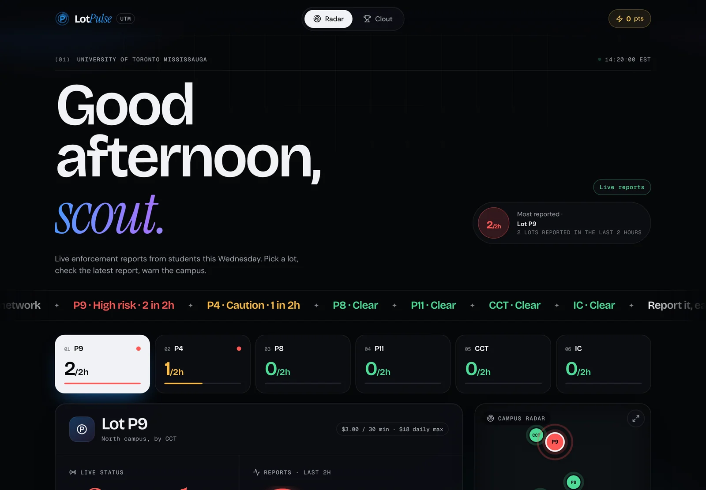
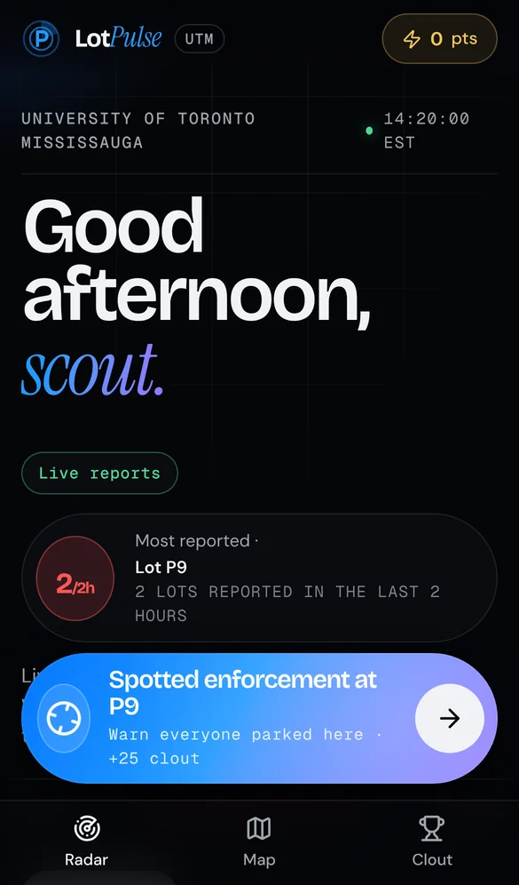
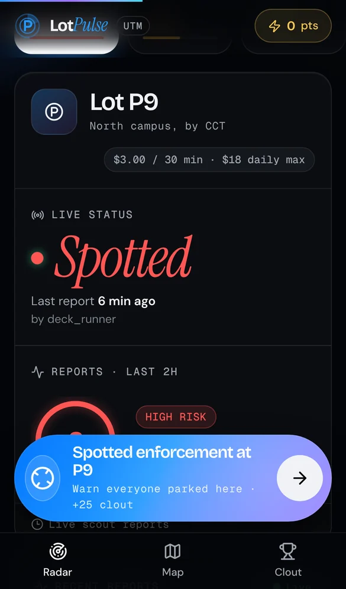
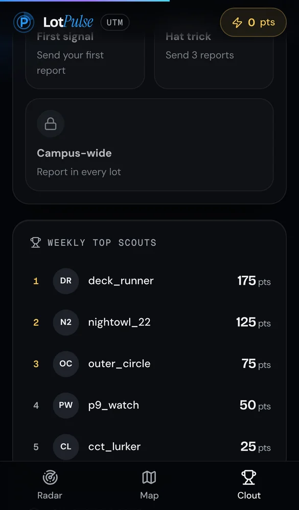
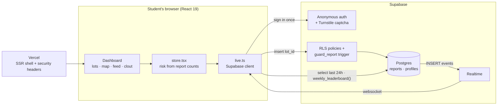

# LotPulse

**Live parking enforcement reports for students at the University of Toronto Mississauga.**

[](https://github.com/aboodgitawaida/LotPulse/actions/workflows/ci.yml)
[](LICENSE)


### [Open LotPulse → lotpulse-utm.vercel.app](https://lotpulse-utm.vercel.app)



<p align="center">
  
  
  
</p>
<p align="center"><sub>Screenshots show sample reports.</sub></p>

Think Waze's police reports, for one campus's parking lots. A student spots enforcement, taps
once, and every student watching that lot sees it within a second or two. Each lot shows:

- **Last report**: when a student last reported enforcement there, and who (by scout name).
- **Risk level**: how many reports the lot got in the last 2 hours (clear, caution, high risk).
- **One-tap reporting**: spot an enforcer, warn campus, earn clout.
- **Clout system**: a weekly scout leaderboard and badges.

Everything shown comes from real student reports. Reports are crowd-sourced and unverified.
LotPulse isn't affiliated with UTM. For real parking, use UTM's official services.

## Engineering highlights

- **Realtime, multi-device.** Reports reach every open page through Supabase Realtime, and
  phones that slept or lost connection catch up when they come back.
- **Fails safe.** If reports can't be loaded (bad Wi-Fi, an outage), lots show "Unknown" with a
  banner instead of a false "Clear", and the app retries until it reconnects.
- **Security enforced by the database, not the browser.** Row level security allows public reads
  of the last 24 hours and inserts only as yourself. A trigger stamps the server time and
  reporter, and enforces a 5-minute per-lot cooldown and 6 reports an hour, so a modified client
  can't get around any of it.
- **Abuse protection without accounts.** Anonymous sign-in keeps reporting to one tap; a
  Cloudflare Turnstile check before a scout's first report stops scripted account farms.
- **Privacy by design.** A report is only a lot, a time and a self-chosen scout name. Older
  reports drop out of public view after 24 hours, the leaderboard only exposes totals, and
  **Delete my data** wipes a scout's name, reports and account in one tap. Only the browser that
  owns the anonymous account can call it, so there's no support inbox to trick.
- **Tested against real Postgres.** Every migration runs in PGlite in the test suite, which
  checks the policies, cooldowns and rate limits; CI runs typecheck, lint, format, tests and a production build on every pull request.
- **Hardened and fast.** Strict security headers (CSP, frame blocking), a map locked to campus
  with automatic tile-provider fallback, and animations tuned to hold 60 fps on mid-range phones.

## Architecture



The browser only ever sends a lot ID. Who reported it, when, and whether it's allowed are all
decided by the database, so the rules hold even against a modified client.

## Getting started

Requires **Node 20.19+** and [Bun](https://bun.sh) (npm also works).

```sh
bun install
bun run dev        # http://localhost:3000
```

| Script           | What it does                         |
| ---------------- | ------------------------------------ |
| `bun run dev`    | Start the dev server with hot reload |
| `bun run build`  | Production build into `.output/`     |
| `bun run start`  | Serve the production build with Node |
| `bun run check`  | Typecheck, lint and run the tests    |
| `bun run format` | Format everything with Prettier      |

Without the Supabase environment variables the app runs but is **not connected**: it shows no
reports and won't send any. The campus map uses [Leaflet](https://leafletjs.com) with the public OpenStreetMap tiles
(darkened with CSS) and Esri satellite imagery, which need no key. Those servers aren't meant for
app traffic and may throttle or block a busy site, so set `VITE_MAPTILER_KEY`
([MapTiler](https://www.maptiler.com), free for 100k map loads a month) as a backup: when the
public tiles fail, the map switches to MapTiler for that visit, with the same darkened look. The
key is public by design: in MapTiler, restrict it to your domains.

## How live reports work

1. **Reporting.** "Spotted enforcement at P9" inserts a row into the Supabase `reports` table
   (`id`, `lot_id`, `created_at`, `reporter_id`). The first time, the browser signs in with
   **Supabase anonymous auth** (no email or password) and the student picks a public scout name.
   On success the dialog closes and a confirmation appears; on failure the dialog stays open and
   says why (no connection, 5-minute cooldown, name taken…).
2. **Live updates.** Every open page subscribes to **Supabase Realtime** inserts on `reports`.
   A new report lands on every device within a second or two, with no refresh, updating the map
   pins, lot cards, "Last report" and the feed. Phones that were asleep or lost their connection
   refetch on wake and on reconnect.
3. **What the numbers mean.**
   - _Last report X min ago_: the newest report for that lot (from the last 24 hours), or
     "No recent reports".
   - _Risk_: reports for that lot in the last **2 hours**. **0 = clear** (green), **1 = caution**
     (amber), **2 or more = high risk** (red). That's the whole rule (`riskFor` in
     `src/lib/lots.ts`).
   - _Clout_: **+25 per report**, counted by the database from your reports since Monday
     (`weekly_leaderboard()`), so nobody can edit their own points.
4. **Rules the database enforces** (`supabase/migrations/`, tested in
   `src/test/database.test.ts`):
   - Anyone can read reports from the last 24 hours (older ones only by their reporter).
   - A signed-in user can only insert their own report: the client sends just the `lot_id`, and the
     `guard_report` trigger sets `reporter_id` to the caller and `created_at` to server time.
   - No updates or deletes from the client, except `delete_my_data()`, which removes only the
     caller's own reports and account. The API roles don't even hold update or delete privileges,
     so a policy added by mistake can't open the tables up.
   - One report per user per lot every **5 minutes**, and at most 6 an hour.
   - Scout names can't pose as staff or the app, and slurs or obscene words are refused, including
     leetspeak, stretched letters and camelCase (`username_is_offensive()`), without blocking
     ordinary words that contain them, like _class_ or _scoutwatch_.

### Setting it up

1. **Database.** Apply the migrations in `supabase/migrations/` in order. If the Supabase GitHub
   integration is connected with "Deploy to production" on, merging to `main` does it. Otherwise
   paste all of `supabase/setup.sql` into the Supabase **SQL Editor** and press **Run**: it applies
   every migration you haven't run yet, oldest first, in one transaction, and is safe to run again.
   It's generated from the migrations (`bun run db:setup-sql` after adding one).
2. **Anonymous sign-in.** In Supabase, open **Authentication → Sign In / Providers** and turn on
   **Allow anonymous sign-ins**.
3. **Realtime.** The migrations add `reports` to the `supabase_realtime` publication. To check,
   open **Database → Publications → supabase_realtime** and make sure `reports` is ticked.
4. **Keys.** In Vercel (**Project → Settings → Environment Variables**) add, for Production and
   Preview:
   - `VITE_SUPABASE_URL`: your project URL, e.g. `https://abcd1234.supabase.co`
   - `VITE_SUPABASE_PUBLISHABLE_KEY`: the publishable (`sb_publishable_…`) or legacy anon key

   Then **redeploy**: Vite bakes these into the build, so existing deployments won't pick them up.
   For local development copy `.env.example` to `.env`.

5. **Check it.** `bun run verify:live` signs in anonymously with the publishable key, reports P9,
   reads it back, waits for the Realtime event on a second client, checks the live site was built
   with the keys, then deletes its test data through the same `delete_my_data()` function behind
   the app's **Delete my data** button. It needs only the same two variables as the app. (With
   Turnstile switched on, anonymous sign-ins need a captcha, so run it before step 7.)

6. **Optional.** `VITE_SITE_URL` sets the absolute URL used in link previews (it defaults to
   Vercel's production domain).
7. **Bot check (Cloudflare Turnstile).** Anonymous accounts are free to create, so without a
   captcha one script can make thousands and flood the map. In Cloudflare, add a Turnstile widget
   (Managed mode) for your production hostname, then:
   - set `VITE_TURNSTILE_SITE_KEY` in Vercel to its **site key** and redeploy. The report dialog
     then shows the check before a scout's first report;
   - only once that deploy is live, open Supabase **Authentication → Attack Protection**, enable
     Captcha protection with Turnstile, paste the **secret key** and save. Saving first would make
     every first report fail, because the old site sends no captcha token.

   With captcha on, `bun run verify:live` can't sign in (it has no token). Turn captcha off while
   running it, or skip it.

## Testing

`bun run check` runs the TypeScript compiler (strict mode), ESLint, Prettier and the Vitest suite.
CI runs the same checks, a dependency audit and a production build on every push and pull request.

- **Database**: `src/test/database.test.ts` runs every migration in [PGlite](https://pglite.dev)
  (Postgres compiled to WebAssembly) with Supabase's default grants, then checks the policies,
  cooldowns, rate limits, data deletion and the leaderboard as real `anon` and `authenticated`
  roles.
- **App**: React Testing Library tests drive the store, live data layer and components against
  a fake Supabase client, including Realtime events, reconnects and failure states.
- **Live check**: `bun run verify:live` reports, reads back, listens over Realtime and cleans
  up against the real project (see step 5 above).

## Deploying to Vercel

Security headers (CSP, frame blocking, referrer policy) are set in `vite.config.ts` through Nitro
route rules, so they ship with every deploy.

1. Push this repository to GitHub.
2. In Vercel, choose **Add New → Project** and import the repo.
3. Keep the detected defaults (Bun install, `bun run build`). Nitro detects Vercel
   automatically and outputs a Vercel-ready build, so no `vercel.json` is required.

Every branch gets its own preview URL, and `main` deploys to production.

## Project layout

```
src/
  routes/          File-based routes (__root.tsx is the HTML shell, index.tsx the dashboard)
  components/      Dashboard UI (focus lot, map, feed, leaderboard, dialogs…)
  components/ui/   Low-level primitives (button, dialog, toaster)
  lib/lots.ts      Single source of truth for lots, positions and the risk rule
  lib/store.tsx    App state: per-lot status from live reports, plus local lot selection
  lib/live.ts      Supabase data: Realtime feed, leaderboard, anonymous sign-in, reporting
  styles.css       Design tokens and component styles
supabase/
  migrations/      Database schema, row level security and guards
  setup.sql        All migrations in one re-runnable script for the SQL Editor (generated)
scripts/           setup.sql generator and the live end-to-end check
docs/screenshots/  README screenshots
```

## Tech

TanStack Start · React 19 · TypeScript · Vite · Tailwind CSS 4 · Supabase (Postgres, Auth,
Realtime) · Leaflet · Radix UI · Vitest · PGlite · Cloudflare Turnstile · Vercel

## Security and privacy

See [SECURITY.md](SECURITY.md) to report a vulnerability, and the in-app
[privacy page](https://lotpulse-utm.vercel.app/privacy) for what's stored and for how long.

## Author

**Abood Awaida** · [GitHub](https://github.com/aboodgitawaida) · [LinkedIn](https://www.linkedin.com/in/abood-awaida/)

## More of my work

- **[Courseflix](https://github.com/aboodgitawaida/Courseflix)**: Netflix-style course discovery for UTM students, with reviews, recommendations and 2,600+ courses. [courseflix.ca](https://www.courseflix.ca)
- **[Vitals](https://github.com/aboodgitawaida/Vitals)**: heart rate from an ordinary webcam, measured entirely in the browser. [vitals-track.vercel.app](https://vitals-track.vercel.app)
- **[Basil](https://github.com/aboodgitawaida/Basil)**: a cosy pixel-art kitchen game that suggests recipes from what's in your fridge. [basil-cat.vercel.app](https://basil-cat.vercel.app)

## License

[MIT](LICENSE) © Abood Awaida
