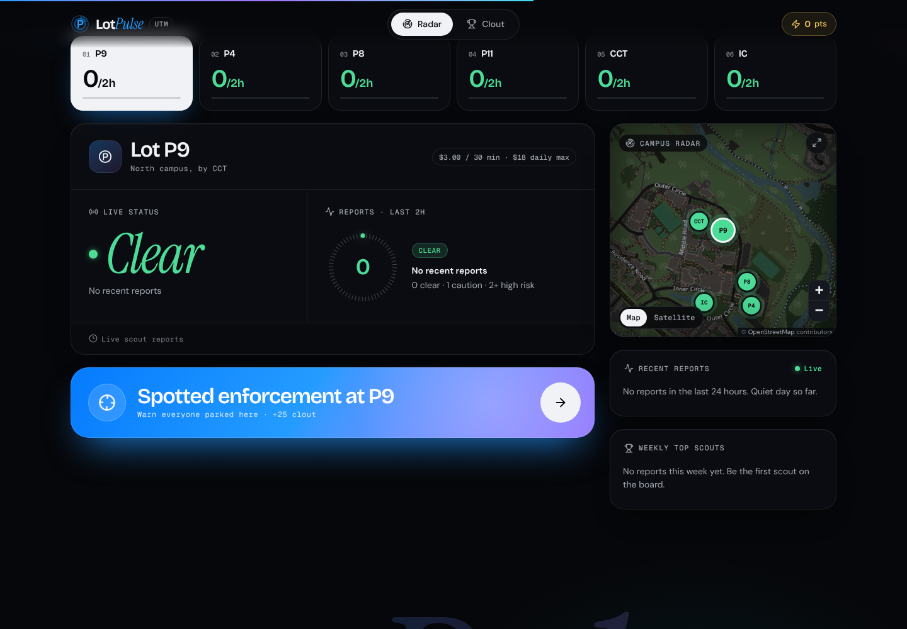
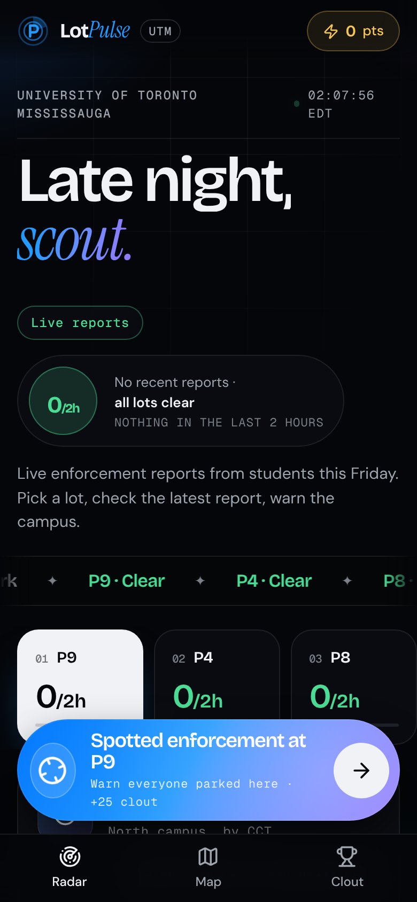
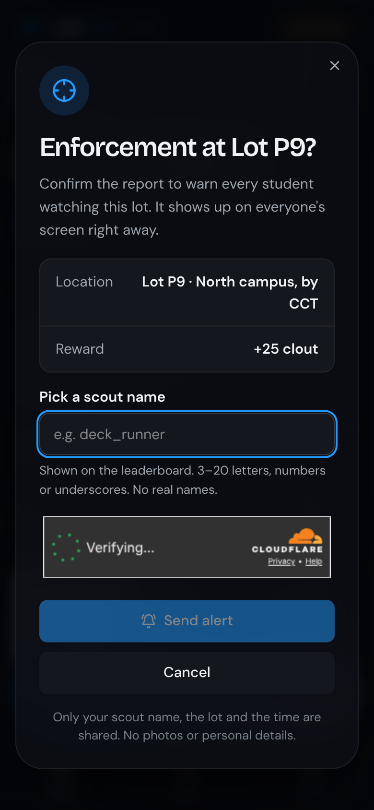
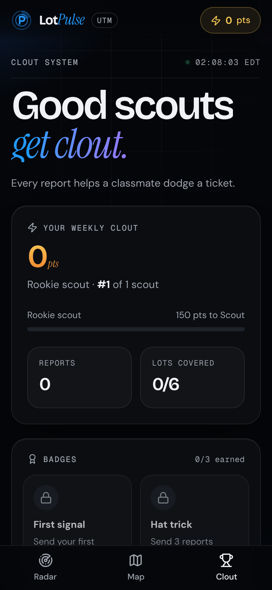
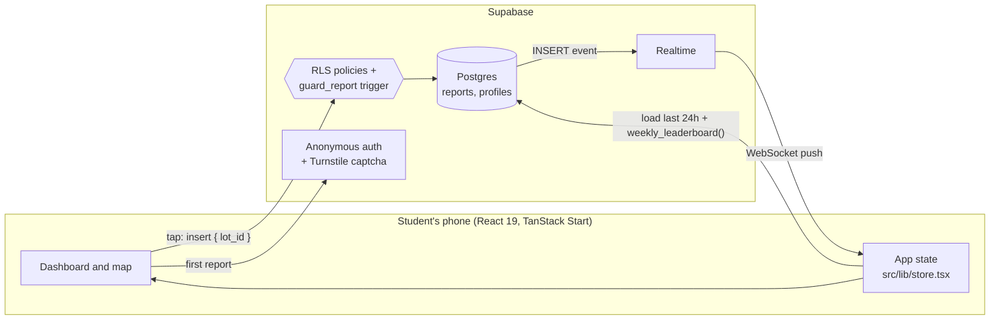

# LotPulse

**Waze-style parking enforcement alerts for UTM students: one tap to warn campus, live on every phone in about a second.**

[](https://github.com/aboodgitawaida/LotPulse/actions/workflows/ci.yml)
[](LICENSE)

**Live app → [lotpulse-utm.vercel.app](https://lotpulse-utm.vercel.app)**

<p>
  
</p>
<p>
  
  
  
</p>

<!-- TODO: add docs/demo.gif, a ~10 second recording of reporting on one phone and the alert appearing on another. -->

## The problem

Parking at the University of Toronto Mississauga is expensive ($15–20 a day at the posted rates),
and a ticket makes it worse. Students already warn each other in group chats, but those messages are
scattered, arrive late and don't say which lot. LotPulse puts every warning in one place, lot by
lot, the moment it happens.

## What it does

- **One-tap reporting.** See enforcement, tap "Spotted enforcement at P9", and every student
  watching that lot sees it within a second or two. No account or email needed.
- **Live risk per lot.** Each of the six lots shows the last report and a risk level from the
  number of reports in the last 2 hours: 0 is clear, 1 is caution, 2 or more is high risk.
- **Campus map.** A Leaflet map locked to UTM, with pins coloured by risk and a satellite view.
- **Clout.** 25 points per report, a weekly leaderboard, tiers and badges, so helping others pays
  off.
- **Privacy built in.** A report is only a lot, a time and a made-up scout name. Reports leave
  public view after 24 hours, and "Delete my data" wipes everything in one tap.

> **No AI here, on purpose.** The project's early name was `lot-spotter-ai`, but there's no model
> and no prediction. Everything shown is a real report from a student, and the risk level is one
> transparent rule you can read in [`src/lib/lots.ts`](src/lib/lots.ts). Guessing when enforcement
> will come would mean showing students made-up data.

## How it works



1. **Reporting.** The client inserts only `{ lot_id }`. On the first report the browser signs in
   anonymously (after a Cloudflare Turnstile bot check) and the student picks a public scout name.
2. **Rules live in the database.** A `BEFORE INSERT` trigger stamps the server time and the
   reporter, enforces a 5-minute cooldown per lot and 6 reports an hour, and takes an advisory lock
   so parallel requests can't slip through. Row-level security allows public reads of the last 24
   hours and inserts only as yourself. Clients can't update or delete anything, apart from
   `delete_my_data()`, which only removes the caller's own data.
3. **Live updates.** Every open page subscribes to Realtime inserts on `reports`. Phones that slept
   or lost connection refetch when they come back, and duplicates are merged.
4. **Failing safe.** If reports can't load, lots show "Unknown" with a banner instead of a false
   "Clear", and the app retries until it reconnects.

## Engineering highlights

- **Security enforced server-side.** A modified client can't fake timestamps, post as someone
  else, skip the cooldown or edit its own clout. Clout is counted by the database
  (`weekly_leaderboard()`).
- **Tested against real Postgres.** Every migration runs in [PGlite](https://pglite.dev) in the
  test suite, which checks the RLS policies, cooldowns, rate limits and data deletion. Component
  and state tests use a fake Supabase client.
- **CI on every pull request.** Typecheck, lint with no warnings allowed, format check, tests and a
  production build, plus a Conventional Commits check on PR titles and Dependabot.
- **Hardened headers.** Strict Content-Security-Policy, HSTS, frame blocking and a
  Permissions-Policy, all set in [`vite.config.ts`](vite.config.ts).
- **Resilient map.** Free OpenStreetMap and Esri tiles, with an automatic switch to MapTiler if
  they get throttled.
- **Accessible.** Passes an axe WCAG 2.1 AA scan on every page and in the report dialog. It has a
  skip link, labelled controls and keyboard-reachable map pins.

## Tech stack

| Layer        | Tools                                                                  |
| ------------ | ---------------------------------------------------------------------- |
| Frontend     | React 19, TanStack Start and Router, Tailwind CSS 4, Radix UI, Leaflet |
| Backend      | Supabase: Postgres, row-level security, Realtime, anonymous auth       |
| Abuse checks | Cloudflare Turnstile, database rate limits                             |
| Tooling      | Vite 8, Nitro, Bun, TypeScript (strict), ESLint, Prettier              |
| Testing      | Vitest, Testing Library, PGlite (in-process Postgres)                  |
| Hosting/CI   | Vercel, GitHub Actions (CI, PR title check, Supabase keep-awake ping)  |

## Run it locally

Requires **Node 20.19+** and [Bun](https://bun.sh) (npm also works).

```sh
git clone https://github.com/aboodgitawaida/LotPulse.git
cd LotPulse
bun install
cp .env.example .env   # add your Supabase keys (see below), or leave them empty
bun run dev            # http://localhost:3000
```

Without Supabase keys the app runs but is **not connected**: it shows no reports and won't send any.

| Script                | What it does                                         |
| --------------------- | ---------------------------------------------------- |
| `bun run dev`         | Dev server with hot reload                           |
| `bun run check`       | Typecheck, lint, format check and tests (same as CI) |
| `bun run build`       | Production build into `.output/`                     |
| `bun run start`       | Serve the production build with Node                 |
| `bun run format`      | Format everything with Prettier                      |
| `bun run verify:live` | End-to-end check against a real Supabase project     |

### Environment variables

All are public browser values (Vite bakes them into the build). Never put a secret key in `.env`.

| Variable                        | Required | What it is                                                                     |
| ------------------------------- | -------- | ------------------------------------------------------------------------------ |
| `VITE_SUPABASE_URL`             | Yes      | Your Supabase project URL                                                      |
| `VITE_SUPABASE_PUBLISHABLE_KEY` | Yes      | Supabase publishable (`sb_publishable_…`) or legacy anon key                   |
| `VITE_TURNSTILE_SITE_KEY`       | No       | Cloudflare Turnstile site key: a bot check before a scout's first report       |
| `VITE_MAPTILER_KEY`             | No       | MapTiler key, used only if the free map tiles fail. Restrict it to your domain |
| `VITE_SITE_URL`                 | No       | Absolute URL for link previews (defaults to Vercel's production domain)        |

<details>
<summary><strong>Setting up your own Supabase project</strong></summary>

1. **Database.** Apply the migrations in `supabase/migrations/` in order. With the Supabase GitHub
   integration and "Deploy to production" on, merging to `main` does it. Otherwise paste all of
   `supabase/setup.sql` into the Supabase **SQL Editor** and run it. It applies every migration you
   haven't run yet, oldest first, in one transaction, and is safe to run again. It's generated from
   the migrations by `bun run db:setup-sql`.
2. **Anonymous sign-in.** In **Authentication → Sign In / Providers**, turn on **Allow anonymous
   sign-ins**.
3. **Realtime.** The migrations add `reports` to the `supabase_realtime` publication. Check it
   under **Database → Publications → supabase_realtime**.
4. **Keys.** Add `VITE_SUPABASE_URL` and `VITE_SUPABASE_PUBLISHABLE_KEY` to `.env` locally, and in
   Vercel under **Project → Settings → Environment Variables** for Production and Preview. Then
   **redeploy**, because existing builds won't pick them up.
5. **Check it.** `bun run verify:live` signs in anonymously, reports P9, reads it back, waits for
   the Realtime event on a second client, checks the live site was built with the keys, then deletes
   its test data with `delete_my_data()`. Run it before switching on the captcha in step 6, because
   it can't solve one.
6. **Bot check.** Create a Turnstile widget (Managed mode) in Cloudflare and set
   `VITE_TURNSTILE_SITE_KEY` in Vercel. Redeploy. Only once that deploy is live, enable Captcha
   protection with Turnstile in Supabase **Authentication → Attack Protection** and paste the
   **secret** key there. Doing it in the other order makes every first report fail.
7. **Keep it awake.** Supabase pauses free projects after a week without activity. The
   `keep-awake` workflow reads one row every 3 days. It needs the repository secrets
   `SUPABASE_URL` and `SUPABASE_PUBLISHABLE_KEY`.

</details>

### Deploying

Import the repo into Vercel and keep the detected defaults (Bun install, `bun run build`). Nitro
detects Vercel and outputs a ready build, so no `vercel.json` is needed. Every branch gets a preview
URL, and `main` deploys to production.

## Project layout

```
src/
  routes/          Pages: __root.tsx (HTML shell, meta, 404), index.tsx (dashboard), privacy.tsx
  components/      Dashboard UI: focus lot, map, feed, leaderboard, dialogs…
  components/ui/   Low-level primitives (button, dialog, toaster)
  lib/lots.ts      Single source of truth for lots, positions and the risk rule
  lib/live.ts      Supabase: Realtime feed, leaderboard, anonymous sign-in, reporting
  lib/store.tsx    App state: per-lot status from live reports, plus lot selection
  styles.css       Design tokens and component styles
  test/            Database (PGlite) and routing tests, Supabase fake
supabase/
  migrations/      Schema, row-level security and guards
  setup.sql        All migrations as one re-runnable script (generated)
scripts/           setup.sql generator and the live end-to-end check
```

## Roadmap

- [ ] "Watch my lot" push notifications (web push from the PWA), so students don't need the app open
- [ ] Moderation: hide a false report or rename an abusive scout name
- [ ] Error monitoring (e.g. Sentry) and privacy-friendly usage counts
- [ ] Playwright end-to-end test of the report flow across two browsers
- [ ] More lots and buildings, plus a yearly check of posted rates
- [ ] Optional history view: which hours have the most reports (real counts, no predictions)

## Privacy and disclaimer

LotPulse stores only what a report needs: a lot, a time and a self-chosen scout name. There's no
email, location, photos, ads, analytics or tracking cookies. See the in-app
[privacy page](https://lotpulse-utm.vercel.app/privacy).

Reports are crowd-sourced and unverified. LotPulse is a student project and isn't affiliated with
the University of Toronto. Always follow posted parking rules.

## Contributing

See [CONTRIBUTING.md](CONTRIBUTING.md). Commits and PR titles follow
[Conventional Commits](https://www.conventionalcommits.org/).

## License

[MIT](LICENSE) © Abood Awaida
